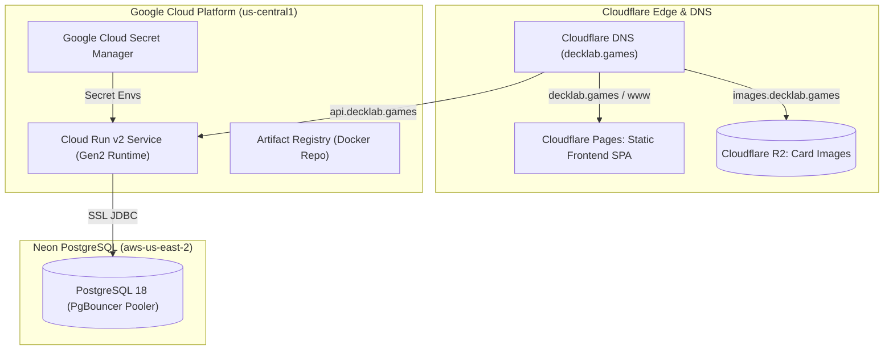

# DeckLab Infrastructure, Secrets, and DevOps Guide

This directory holds DeckLab's production **Infrastructure as Code (IaC)** in [OpenTofu](https://opentofu.org/), a provider-neutral Terraform engine. It defines the cloud stack across Google Cloud (`us-central1`), Neon (`aws-us-east-2`), and Cloudflare: an Artifact Registry repository, a Cloud Run v2 backend service, a Neon PostgreSQL 18 database, a Cloudflare R2 bucket for card artwork, a Cloudflare Pages project for the static frontend, and Cloudflare DNS records.

---

## Architecture Overview



---

## Infrastructure resources

| Module                   | Resources Provisioned                                                                                                   | Purpose                                                                                                 |
| ------------------------ | ----------------------------------------------------------------------------------------------------------------------- | ------------------------------------------------------------------------------------------------------- |
| `modules/registry`       | `google_artifact_registry_repository`                                                                                   | Docker registry for backend container images with retention cleanup policies                            |
| `modules/database`       | `neon_project` (PostgreSQL 18), `neon_database`                                                                         | Managed PostgreSQL persistence (`deck-lab` in `aws-us-east-2`) with pooled and direct endpoints         |
| `modules/storage`        | `cloudflare_r2_bucket`, `cloudflare_r2_custom_domain`                                                                   | Card artwork bucket (`deck-lab-images-prod`) served on `images.decklab.games`                           |
| `modules/backend`        | `google_cloud_run_v2_service`, `google_cloud_run_domain_mapping`, `google_service_account`, `google_secret_manager_*` x3 | Gen2 backend container mapped to `api.decklab.games` with Secret Manager injection                      |
| `modules/cloudflare_dns` | `cloudflare_pages_project`, `cloudflare_pages_domain` x2, `cloudflare_dns_record` (`apex`, `www`, `api`)                | Cloudflare Pages project (`deck-lab`), custom domain bindings, and CNAME routing for frontend and API   |

---

## Quickstart & Local IaC Commands

### Prerequisites

1. **OpenTofu**: Install OpenTofu CLI (`brew install opentofu` or `tofu version >= 1.8.0`).
2. **GCP Authentication**: Authenticate locally with Application Default Credentials (ADC):
   ```bash
   gcloud auth application-default login
   ```
3. **Required GCP APIs**: Enable these APIs:
   ```bash
   gcloud services enable run.googleapis.com secretmanager.googleapis.com artifactregistry.googleapis.com iam.googleapis.com
   ```

### Execution Workflow

```bash
cd infra

# 1. Initialize OpenTofu (downloads google, cloudflare, and neon providers)
tofu init -upgrade

# 2. Format & Validate
tofu fmt -recursive
tofu validate

# 3. Configure Variables
cp terraform.tfvars.example terraform.tfvars
# Edit terraform.tfvars with your project IDs and secrets (file is gitignored)

# 4. Plan & Apply
tofu plan -var-file=terraform.tfvars
tofu apply -var-file=terraform.tfvars
```

---

## Remote State Management

To share infrastructure state across team members and CI/CD pipelines:

1. The remote state backend is configured in [`backend.tf`](./backend.tf) pointing to `gs://deck-lab-tfstate`.
2. Initialize OpenTofu against the GCS backend:
   ```bash
   tofu init
   ```

---

## Secrets and Environment Variables Hierarchy

### 1. Local Development (`.env`)

Copy the root `.env.example` to `.env`. Docker Compose uses this single file:

```bash
cp .env.example .env
docker compose up -d
```

### 2. Google Cloud Secret Manager

In production, secrets live in Secret Manager and Cloud Run mounts them as environment variables:

| Secret Manager Secret ID  | Cloud Run Environment Variable | Description                               |
| ------------------------- | ------------------------------ | ----------------------------------------- |
| `DECK_LAB_DB_PASSWORD`    | `POSTGRES_PASSWORD`            | PostgreSQL user password                  |
| `DECK_LAB_JWT_SECRET`     | `JWT_SECRET`                   | 512-bit Base64 signing key for JWT tokens |
| `DECK_LAB_GEMINI_API_KEY` | `GEMINI_API_KEY`               | Google Gemini API key for AI generation   |

### 3. GitHub Actions Repository Secrets

The deploy workflow (`.github/workflows/deploy.yml`) needs these repository secrets set in **GitHub > Repository Settings > Secrets and variables > Actions**:

| GitHub Secret Name        | Description                                                | Value / Note for `deck-lab`                                                                              |
| ------------------------- | ---------------------------------------------------------- | -------------------------------------------------------------------------------------------------------- |
| `GCP_PROJECT_ID`          | Google Cloud Project ID                                    | `deck-lab`                                                                                               |
| `GCP_WIF_PROVIDER`        | Workload Identity Provider resource URI                    | `projects/123/locations/global/workloadIdentityPools/github/providers/github-provider`                   |
| `GCP_WIF_SERVICE_ACCOUNT` | GitHub Actions deployer Service Account                    | `github-deployer@deck-lab.iam.gserviceaccount.com`                                                       |
| `SPRING_DATASOURCE_URL`   | Pooled PostgreSQL JDBC URL (`tofu output -raw neon_jdbc_url`) | `jdbc:postgresql://<pooler-host>/deck-lab?sslmode=require&reWriteBatchedInserts=true&prepareThreshold=0` |
| `DB_USER`                 | PostgreSQL application user (`tofu output -raw neon_db_user`) | `neondb_owner`                                                                                           |
| `ALLOWED_CORS_ORIGINS`    | Comma-separated allowed CORS origins                       | `https://decklab.games,https://www.decklab.games`                                                        |
| `CLOUDFLARE_API_TOKEN`    | Cloudflare API token with Pages Edit permission            | `<CLOUDFLARE_API_TOKEN>`                                                                                 |
| `CLOUDFLARE_ACCOUNT_ID`   | Cloudflare Account ID                                      | `<CLOUDFLARE_ACCOUNT_ID>`                                                                                |

---

## Cloudflare Configuration

Cloudflare manages DNS, Pages hosting, and R2 storage for `decklab.games`.

### Option A: Automated via OpenTofu

Configure the following in `terraform.tfvars`:

```hcl
enable_cloudflare_dns = true
cloudflare_account_id = "<CLOUDFLARE_ACCOUNT_ID>"
cloudflare_zone_id    = "<CLOUDFLARE_ZONE_ID>"
cloudflare_api_token  = "<CLOUDFLARE_API_KEY>" # Token with Zone.DNS, Pages, and R2 Edit permissions
```

OpenTofu provisions and synchronizes:

- Cloudflare Pages project `deck-lab` with custom domains `decklab.games` and `www.decklab.games`
- Cloudflare R2 bucket `deck-lab-images-prod` bound to `images.decklab.games`
- Apex `@` and `www` `CNAME` records $\rightarrow$ `deck-lab.pages.dev` (`proxied = true`)
- Subdomain `api` `CNAME` record $\rightarrow$ `ghs.googlehosted.com` (`proxied = false`) for Cloud Run custom domain TLS verification

### Option B: Manual via Cloudflare Dashboard

If `enable_cloudflare_dns = false`:

1. Create the Cloudflare Pages project `deck-lab` and attach `decklab.games` and `www.decklab.games`.
2. Attach the custom domain `images.decklab.games` to the R2 bucket `deck-lab-images-prod`.
3. Add a DNS-only `CNAME` record for `api` pointing to `ghs.googlehosted.com`.

---

## Mobile Build Configuration (`--dart-define`)

When building the Flutter mobile application for release, pass the production API and image URLs:

```bash
cd mobile
flutter build apk --release \
  --dart-define=API_BASE_URL=https://api.decklab.games \
  --dart-define=IMAGES_BASE_URL=https://images.decklab.games
```

In local development, `ApiClient` automatically detects Android Emulator (`10.0.2.2:8080`) or iOS Simulator (`localhost:8080`).

---

## Secret Rotation Playbooks

### Rotating JWT Secret

1. Generate a new 512-bit base64 key:
   ```bash
   NEW_KEY=$(openssl rand -base64 64 | tr -d '\n')
   ```
2. Add a new secret version in Google Secret Manager:
   ```bash
   echo -n "$NEW_KEY" | gcloud secrets versions add DECK_LAB_JWT_SECRET --data-file=- --project=deck-lab
   ```
3. Update `jwt_secret` in `infra/terraform.tfvars`.
4. Deploy a new revision of Cloud Run to pick up the new secret version:
   ```bash
   gcloud run services update backend-service --region=us-central1 --project=deck-lab --update-secrets=JWT_SECRET=DECK_LAB_JWT_SECRET:latest
   ```
